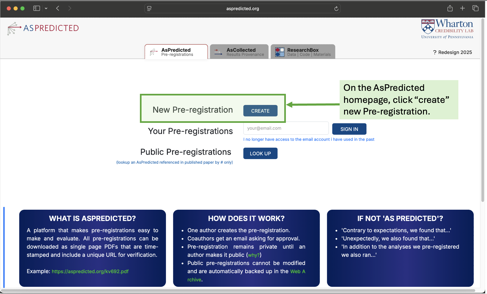
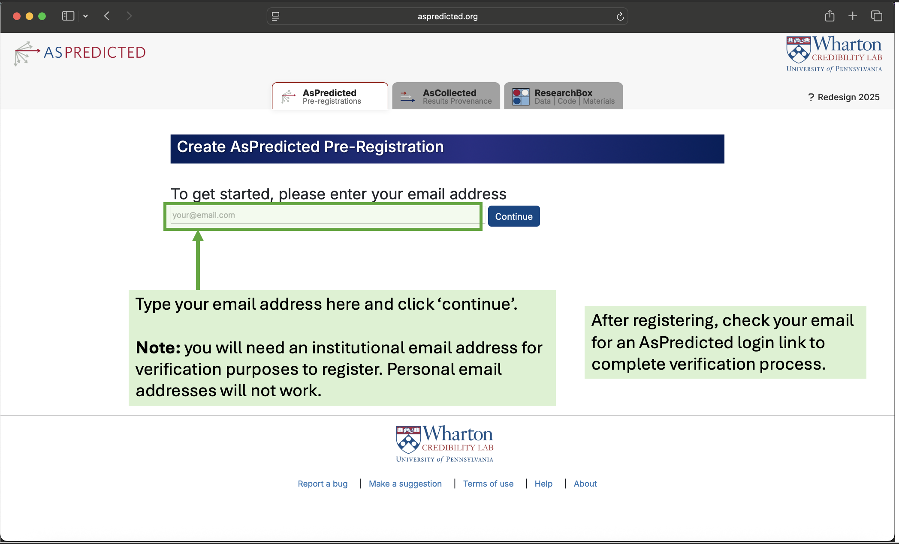
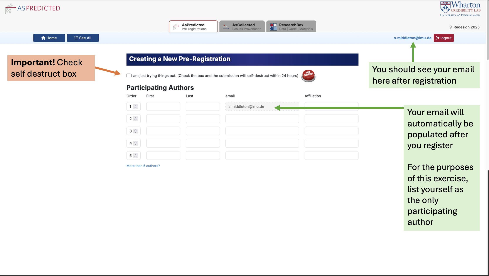
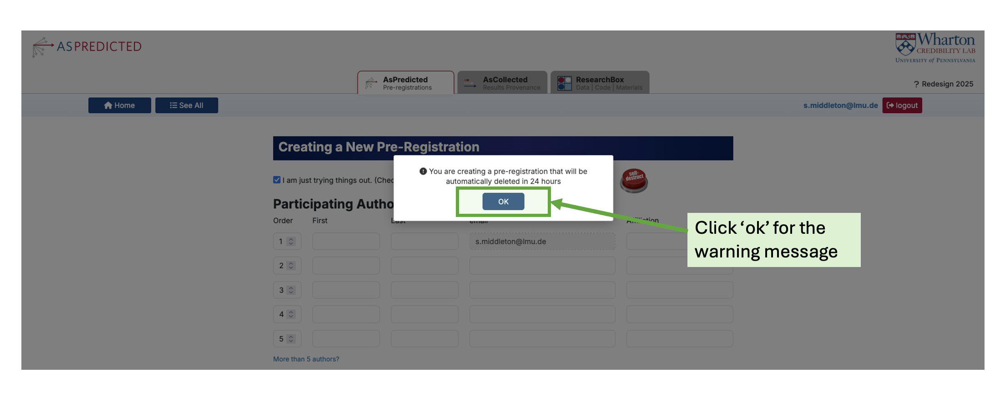
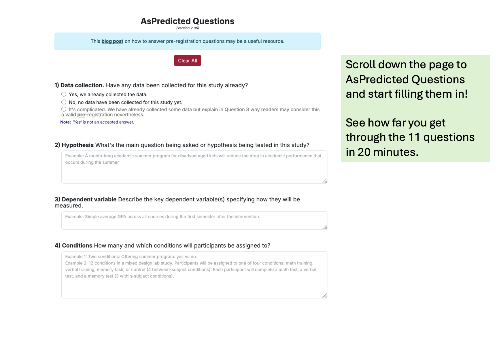

# Practice preregistration

For this final exercise we will be using the preregistration platform AsPredicted. The aim is to increase your familiarity with the process of filling out a study preregistration and noting down any challenges while you practice. For this exercise you can draw from your own research project and have a go at filling the 11 questions in 20 minutes. 20 minutes should be sufficient time to get a taster for the process. After 20 minutes, spend 5 minutes going through the reflection questions below to help you think about your experience of completing this exercise.

**Prerequisites:**

- Completion of the build up your preregistration toolkit exercise \[LINK\]

- Learners are currently in the conceptualization stage of research study (e.g. formulating research questions, literature review, and data collection methods).

- Access the ASPredicted [platform](https://aspredicted.org)

- An institutional email address

**Learning objectives:** *Practice* and *evaluate* the process of implementing components of a study preregistration.

## Instructions

Instructions are numbered below for setting up AsPredicted preregistration template (should take no more than 3 minutes).

### Step 1: Find the AsPredicted homepage

Visit <https://aspredicted.org> and create a new preregistration. On the AsPredicted homepage, click “create” new Pre-registration.

{fig-alt="A screenshot of the as predicted homepage. A green box is highlighting the \"new preregistration\" creation button." fig-align="center"}

### Step 2: Register and verfiy email

Submit your institutional email address to register (if you have an account already you can skip this step).

::: {.callout-warning title="Warning" collapse="false"}
You will need an **institutional email address** for verification purposes to register. Personal email addresses will not work. After registering, remember to check your email for an AsPredicted login link to **complete verification process**.
:::

{fig-alt="An annotated screenshot of the registration page for the aspredicted preregistration platform. There is a green box highlighting the email address box." fig-align="center"}

### Step 3: Create a "practice mode" new preregistration

Check you see your email in the top right of the screen (this is a sign that you have successfully registered). Your email address should also appear automatically in the "Participating Authors" field under "Creating a New Pre-Registration" section. For the purposes of this exercise, list yourself as the only participating author. Press the self destruct button, which is essentially the practice mode version of a study preregistration. All your answers will be deleted after 24 hours.

::: {.callout-warning title="Warning" collapse="false"}
**Press the self destruct button**, which is essentially the practice mode version of a study preregistration. **All your answers will be deleted after 24 hours**.
:::

{fig-alt="An annotated screenshot of the aspredicted \"creating a new preregistration page\"." fig-align="center"}

Click "ok" for the warning message.

{fig-alt="an annotated screenshot of the aspredicted \"creating a new preregistration page\" showing a green box highlighting the ok button in the warning message." fig-align="center"}

### Step 4: Fill out the preregistration template

For 20 minutes have a go at filling in the preregistration for an upcoming study. There are 11 questions, see how far you get through them in 20 minutes.

{fig-alt="Annotated screenshot of aspredicted preregistration questions." fig-align="center"}

### Step 5: Reflect on the exercise

After 20 minutes, spend 5 minutes reflecting on the process using reflection questions below

::: {.callout-note title="Reflection questions" collapse="false"}
1.  Did you go through the questions in order?

2.  Were there any questions you were not expecting?

3.  What was the most challenging part of the preregistration process?
:::

::: {.callout-tip title="Tip" collapse="false"}
Depending on your subject area/research methods you can do a similar exercise using different templates [here](https://osf.io/zab38/wiki?wiki=dmbcy).
:::

Well done for completing the final exercise! 
