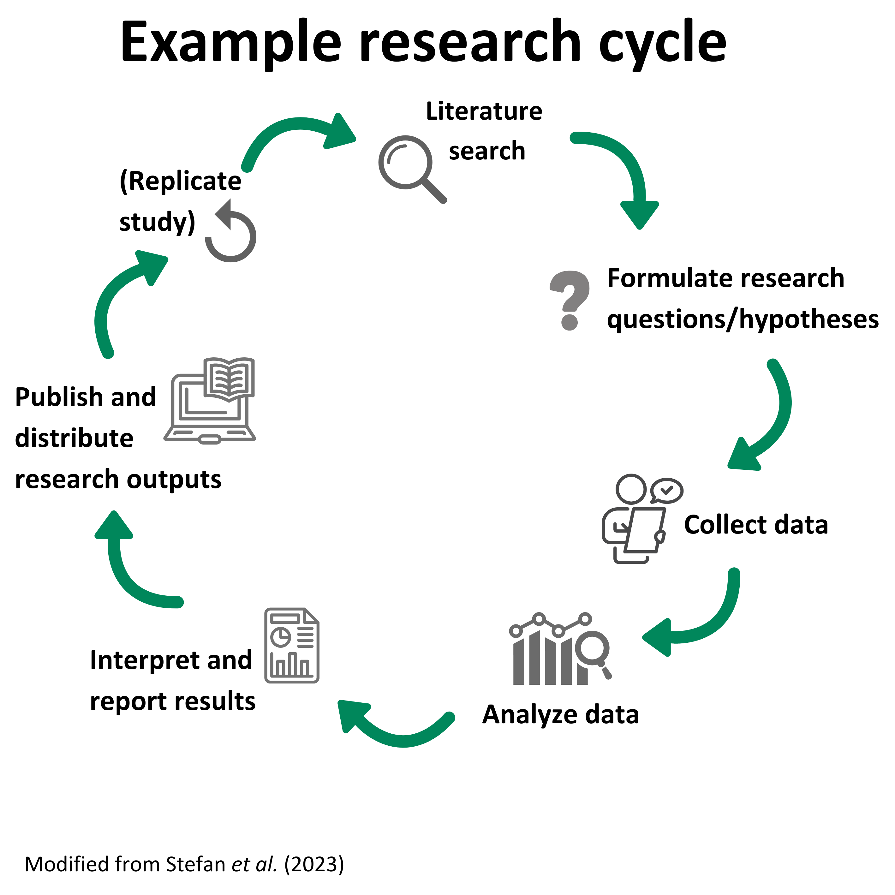

## A researcher's freedom to decide

As researchers we make lots of decisions throughout the life cycle of a
research project: Which hypotheses to test? How big a sample size is
needed? How long should the data collection period be? Which statistical
test(s) is most appropriate? Because of the great flexibility in how
research can be conducted (known as researcher degrees of freedom),
**how** and **when** we make these decisions matters for the credibility
of science. Decisions made after data collection or analysis open us up
to inadvertently influencing the findings instead of data driving the
outcomes.

::: {.callout-note title="Reflection point" collapse="true"}
When decisions are made in the research process are often not clearly
communicated in a typical published study.

Think about the last published study you read, can you tell if the
research questions or hypotheses were formulated *before* or *after* the
study findings were known, and does this matter?

Short answer is: no, you cannot really tell and yes it does matter!
:::

These post-hoc decisions can look like researchers following an
exploratory, hypothesis generating approach and then reporting their
outcomes as grounded in theory and planned. Other times researchers can
decide to report the "best" studies from a series of studies and label
the other studies as "failures". Even to refining the study design while
exploring the data. As researchers we are keen to make sure our
approaches are "right", yet we do not always account for our biases or
forget what we originally planned. The issues raised by this flexible
decision making process comes under the umbrella of questionable
research practices (QRPs). We will cover the topic of QRPs in more
detail in the [Questionable research practices](qrps.qmd) page.

::: callout-important
Recognizing the difference between exploratory and hypothesis testing
approaches both as a *contributor* to and *consumer* of research is
critical for transparent and credible science [@nosek2018].
:::

## Questioning how we do research

Over the past couple of decades, researchers raised major concerns about
the credibility of science ("Credibility Crisis") as many studies were
unable to be replicated. EDIT

::: {style="text-align: center;"}

:::

## Preregistration as part of the credibility revolution

A strategy to address the "crisis" is the practice of study
preregistration. Preregistrations aim to:

- reduce bias

- increase transparency

- clarify exploratory vs hypothesis testing.

This is works by producing an uneditable time-stamped document that
outlines a study plan including research questions/hypotheses, research
design, data analysis *before* data collection and analysis. A study
preregistration is then uploaded onto a verified repository so that it
can be publicly shared with others (possibly after an embargo period)
(Nosek, 2018; Parsons et al. 2022). Importantly, preregistration remains
agnostic when it comes to exploratory and hypothesis testing approach to
research, it aims to clearly differentiate between the two.

::: callout-caution
### Terminology

You may notice in the literature different terms relating to
preregistration like *study registration*. Some researchers are
advocating for a reform of terms to avoid ambiguity, as some terms can
refer to different practices occurring at various stages of the research
life cycle [@mayo-wilson2025]. In this tutorial, we will use the term
preregistration.
:::

One of the earliest formal implementations of registrations comes from
medical clinical trials. More recently, researchers and journals in the
field of psychology have rapidly adopted this practice. Preregistration
is relevant to all kinds of research:

- **Qualitative** (interview study, focus groups, ethnographic)
- **Review-based** (systematic, narrative)
- **Intervention/experimental** (randomized control trials, factorial
  design)
- **Observational** (case study, natural experiment, longitudinal)

::: callout-note
### Did you know?

The concept of preregistration is not new! The scientist and philosopher
Charles Sanders Peirce in \~1880s created a set of rules to test "the
truth", with one being that hypotheses should be stated *before* data
collection [@peirce1883].
:::

Being able to understand the different research approaches, study
designs and key concepts will help provide context for the steps
required to do a study preregistration. We will explore some [research
methods](research-cycle.qmd).

### What would you do?

Imagine if your PhD lab mate Max came to you with this dilemma:

"I've been analyzing the data from my first thesis chapter (which I
really want to publish, as it will help with my chances of getting a
post doc). One of my hypotheses is that X influences Y. I've measured
many variables to test this hypothesis. However during the data
analysis, results seem to show X has no effect on Y, unless I remove a
variable. Do you have any suggestions of what I should do?"

What would you recommend Max does from the options listed below?

- [ ] A) Remove that variable from the analysis

- [ ] B) Tweak the hypothesis to match the results

- [ ] C) Collect more data in the hope, a larger sample size will show
  an effect

- [ ] D) Try out a new statistical test to see if there is a significant
  effect

- [ ] E) Leave that variable in and write up the results as they are

We will revisit Max's dilemma throughout this tutorial and hopefully by
the end you will be more confident at identifying potential issues and
recognize how preregistration can help safeguard against questionable
research practice and promote more credible research.

## Summary

- Researchers make a lot of decisions during the research process

- **How** and **when** researchers make these decisions matters for the
  credibility of science

- Preregistration is a practice that aims to reduce bias, increase
  transparency, clarify exploratory vs hypothesis testing.
