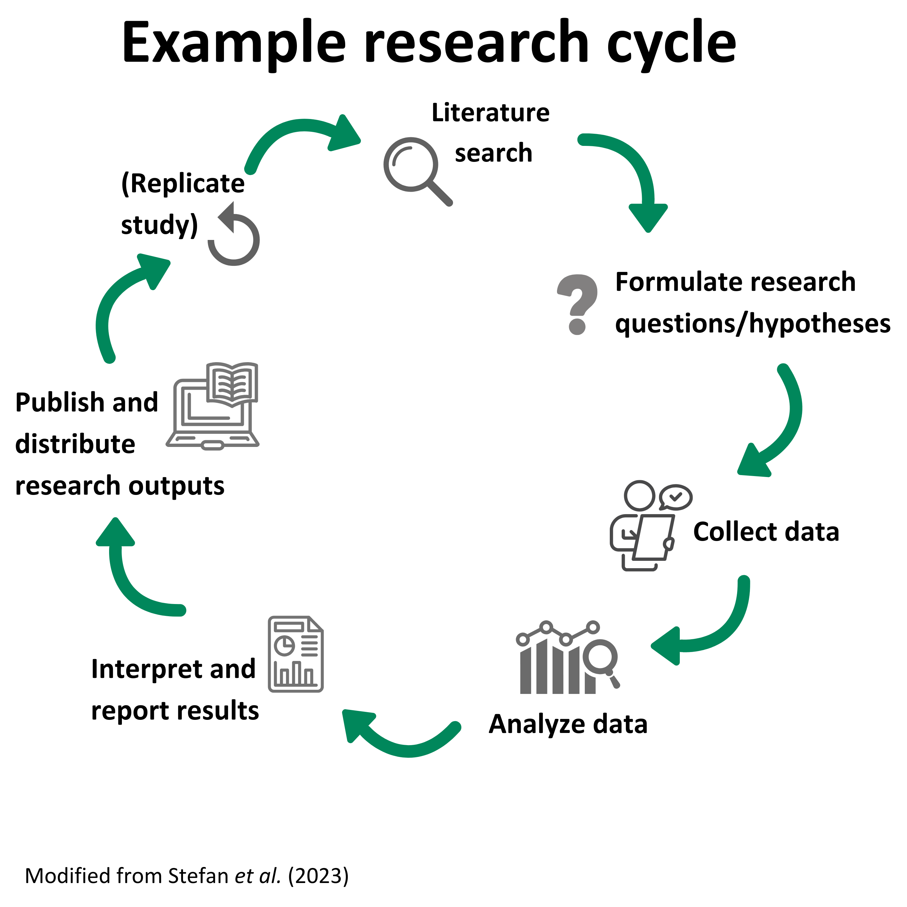

# What even is preregistration?

When reading a typical journal article, can you tell if the research questions or hypotheses were formulated *before* or *after* the study findings were known, and does this matter? Short answer is: no you can't really tell and yes it does matter! Recognizing the difference between predictions and postdictions both as a *contributor* to and *consumer* of research is critical for transparent and credible science (Nosek et al 2018). Conflating predictions and postdictions can lead to...  Presenting postdictions as predictions can increase publishability of findings (e.g. positive and novel results) by falsely reducing uncertainty....

Preregistration is a practice which aims to clarify prediction vs postdiction in a research study. This is works by producing an uneditable time-stamped document that outlines a study plan including research questions/hypotheses, research design, data analysis *before* data collection and analysis. A study preregistration is then uploaded onto a verified repository so that it can be publicly shared with others (possibly after an embargo period) (Nosek, 2018; Parsons et al. 2022). Importantly, preregistration remains agnostic when it comes to prediction vs postdiction approach to research, it aims to clearly differentiate between the two. 

::: callout-warning
## Terminology

You may notice in the literature different terms relating to preregistration like *study registration*. Some researchers are advocating for a reform of terms to avoid ambiguity, as some terms can refer to different practices occurring at various stages of the research life cycle [@mayo-wilson2025]. In this tutorial, we will use the term preregistration.
:::

# Why did the practice of preregistration come about?
The practice of pregistration came about as a response to the credibility crisis and wider research culture (). It acknowledges the tension between researchers' motivations to advance knowledge and to obtain a sustainable career with opportunities for progression, promotion, funding and awards.

The current research culture rewards study outcomes that positive and novel

The lack of clarity between postdiction and prediction creates opportunities for....

provides the opportunity to select, rationalize, and report tests that maximize reward over accuracy. Moreover, good intentions are not sufficient to overcome the fallibility of memory, motivated reasoning, and cognitive biases that can occur outside of conscious awareness or control

Presenting postdictions as predictions can increase the attractiveness and publishability of findings by falsely reducing uncertainty. 
The current research culture Preregistration as a practice should be 

::: callout-tip
## Did you know?
The concept of pregistration is not new! The scientist and philosopher Charles Sanders Peirce in ~1880s created a set of rules to test "the truth", with one being that hypotheses should be stated *before* data collection @peirce1883.
:::

-   One of the earliest formal implementations of registrations comes
    from medical *clinical trials*.

-   More recently, *researchers* and *journals* in the field of
    *psychology* have rapidly adopted this practice
    
::: callout-tip
## Did you know?
The percentage of medical study findings reporting a significant benefit for an intervention dropped by ~50% after the year 2000 when the registry for clinical trials - [clinicaltrials.gov](https://clinicaltrials.gov/) was launched [@kaplan2015]!
:::
    
### The replicability crisis

::: {style="text-align: center;"}

:::

### Questionable research practicess

Questionable research practices (QRPs) are a set of *intentional* or *unintentional* behaviors where researchers distort study findings. Examples include p-hacking and HARKing (Parsons et al. 2022). We will cover the topic of QRPs in more detail in @sec-QRPs.

## Approaches to research

There is no single one way to do research! It all depends on what information you are trying to gather. Research can be:

-   **Qualitative** (interview study, focus groups, ethnographic)
-   **Review-based** (systematic, narrative)
-   **Intervention/experimental** (randomized control trials, factorial design)
-   **Observational** (case study, natural experiment, longitudinal)

::: {.callout-note title="What is your research approach?"}
Being able to understand the different research approaches, study designs and key concepts will help provide context for the steps required to do a study registration.
:::

## What would you do?

Imagine if your PhD lab mate Max came to you with this dilemma: "I've been analyzing the data from my first thesis chapter (which I really want to publish, as it will help with my chances of getting a post doc). One of my hypotheses is that X influences Y. I've measured many variables to test this hypothesis. However during the data analysis, results seem to show X has no effect on Y, unless I remove a variable. Do you have any suggestions of what I should do?"

What would you recommend Max does from the options listed below?
A)  Remove that variable from the analysis
B)  Tweak the hypothesis to match the results
C)  Collect more data in the hope, a larger sample size will show an effect
D)  Try out a new statistical test to see if there is a significant effect
E)  Leave that variable in and write up the results as they are

We will revisit Max's dilemma throughout this tutorial and hopefully by the end you will be more confident at identifying potential issues and recognize how preregistration can help safeguard against questionable research practice and promote more credible research.

::: callout-tip
## Summary
:::
